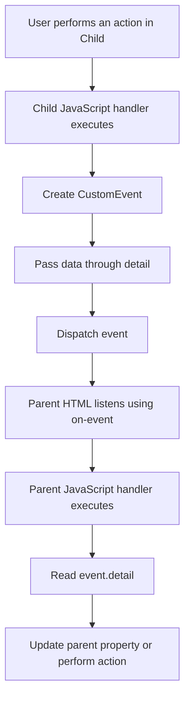

# Child-to-Parent Communication in Salesforce LWC

## Introduction

In Salesforce Lightning Web Components (LWC), components often need to exchange data with each other.

**Child-to-Parent Communication** means sending data or notifying an action from a child component to its parent component.

For example:

- A child component collects a student's name and sends it to the parent.
- A child component sends a selected Contact record to the parent.
- A child component sends form data to the parent when the user clicks Submit.
- A child component notifies the parent when a checkbox, button, or dropdown changes.
- Multiple child components send different information to the same parent component.

The standard approach for child-to-parent communication is **Custom Events**.

## Parent-to-Child vs Child-to-Parent

| Parent-to-Child | Child-to-Parent |
|---|---|
| Data travels downward. | Data travels upward. |
| Uses `@api` properties or public methods. | Usually uses Custom Events. |
| Parent supplies data to the child. | Child sends data or a notification to the parent. |
| Example: Parent sends a username. | Example: Child sends a selected username. |

Remember:

**Properties go down; events go up.**

## How Child-to-Parent Communication Works



### Step-by-step flow

1. The user clicks a button or changes an input in the child component.
2. The child JavaScript method executes.
3. The child creates a custom event using `new CustomEvent()`.
4. Data is attached to the event using the `detail` property, if required.
5. The child dispatches the event using `this.dispatchEvent()`.
6. The parent HTML listens for the event using an attribute such as `onmessage={handleMessage}`.
7. The parent's JavaScript handler receives the event.
8. The parent reads the data from `event.detail`.
9. The parent updates its own properties or performs another action.

## Understanding Custom Events

A Custom Event is an event created by a developer to communicate information or notify another component about an action.

### Basic syntax

```javascript
this.dispatchEvent(
    new CustomEvent('message')
);
```

Here:

- `CustomEvent` creates a custom event.
- `'message'` is the event name.
- `dispatchEvent()` sends the event from the child.
- The parent can listen for that event.

### Understanding the three important parts

| Code | Purpose |
|---|---|
| `new CustomEvent('message')` | Creates an event named `message`. |
| `this.dispatchEvent()` | Dispatches the event. |
| `onmessage={handleMessage}` | Registers the parent's event handler in HTML. |

**Important:** The event name is `message`, but the parent listens using `onmessage`. Do not add `on` to the event name passed to `CustomEvent()`.

---

# Scenario 1: Send a Simple Message from Child to Parent

This is the simplest example. The child sends a fixed message to the parent when a button is clicked.

### Component structure

```text
simpleParent
    |
    └── simpleChild
```

### Child component

**simpleChild.html**

```html
<template>
    <lightning-card title="Child Component">
        <div class="slds-p-around_medium">
            <lightning-button
                label="Send Message"
                onclick={handleSendMessage}>
            </lightning-button>
        </div>
    </lightning-card>
</template>
```

**simpleChild.js**

```javascript
import { LightningElement } from 'lwc';

export default class SimpleChild extends LightningElement {

    handleSendMessage() {

        this.dispatchEvent(
            new CustomEvent('message', {
                detail: 'Hello from Child Component!'
            })
        );

    }
}
```

### Parent component

**simpleParent.html**

```html
<template>
    <lightning-card title="Parent Component">
        <div class="slds-p-around_medium">

            <p>Message: {childMessage}</p>

            <c-simple-child
                onmessage={handleMessage}>
            </c-simple-child>

        </div>
    </lightning-card>
</template>
```

**simpleParent.js**

```javascript
import { LightningElement } from 'lwc';

export default class SimpleParent extends LightningElement {

    childMessage = 'Waiting for child message...';

    handleMessage(event) {

        this.childMessage = event.detail;

    }
}
```

### How the code works

1. The user clicks **Send Message** in the child.
2. `handleSendMessage()` executes.
3. The child dispatches the `message` event.
4. The string is sent through `detail`.
5. The parent listens through `onmessage={handleMessage}`.
6. The parent's `handleMessage()` method executes.
7. `event.detail` returns `Hello from Child Component!`.
8. `childMessage` updates, and the displayed text changes.

### Output

Before clicking:

```text
Message: Waiting for child message...
```

After clicking:

```text
Message: Hello from Child Component!
```

---

# Scenario 2: Send Data Without a Custom Event Payload

Sometimes the parent only needs to know that something happened. It does not need additional data.

### Child JavaScript

```javascript
import { LightningElement } from 'lwc';

export default class SimpleChild extends LightningElement {

    handleClick() {

        this.dispatchEvent(
            new CustomEvent('save')
        );

    }
}
```

### Parent HTML

```html
<c-simple-child onsave={handleSave}>
</c-simple-child>
```

### Parent JavaScript

```javascript
import { LightningElement } from 'lwc';

export default class SimpleParent extends LightningElement {

    handleSave() {

        console.log('Child requested a save operation');

    }
}
```

### Explanation

Here, the child sends only the `save` event.

No `detail` property is necessary because the parent does not need a payload.

**Use this scenario when:** the child only needs to notify the parent that a button was clicked, a save was requested, or an action occurred.

---

# Scenario 3: Send a String, Number, or Boolean

The `detail` property can carry different types of JavaScript values.

## Sending a string

**Child JavaScript**

```javascript
this.dispatchEvent(
    new CustomEvent('valuechange', {
        detail: 'Prince'
    })
);
```

**Parent JavaScript**

```javascript
handleValueChange(event) {

    console.log(event.detail);

}
```

Output:

```text
Prince
```

## Sending a number

**Child JavaScript**

```javascript
this.dispatchEvent(
    new CustomEvent('valuechange', {
        detail: 100
    })
);
```

**Parent JavaScript**

```javascript
handleValueChange(event) {

    console.log(event.detail);

}
```

Output:

```text
100
```

## Sending a Boolean

**Child JavaScript**

```javascript
this.dispatchEvent(
    new CustomEvent('statuschange', {
        detail: true
    })
);
```

**Parent JavaScript**

```javascript
handleStatusChange(event) {

    this.isActive = event.detail;

}
```

If the event sends `true`, `isActive` becomes `true`.

**Important:** `detail` can carry strings, numbers, booleans, objects, arrays, and other JavaScript values.

---

# Scenario 4: Send Input Field Data to the Parent

This scenario is useful when a child component contains a form field and the parent needs the entered value.

For example, the child collects a student's name.

### Child HTML

```html
<template>
    <lightning-card title="Student Form">

        <div class="slds-p-around_medium">

            <lightning-input
                label="Enter Student Name"
                value={studentName}
                onchange={handleNameChange}>
            </lightning-input>

            <lightning-button
                label="Send Name"
                onclick={handleSendName}>
            </lightning-button>

        </div>

    </lightning-card>
</template>
```

### Child JavaScript

```javascript
import { LightningElement } from 'lwc';

export default class SimpleChild extends LightningElement {

    studentName = '';

    handleNameChange(event) {

        this.studentName = event.target.value;

    }

    handleSendName() {

        this.dispatchEvent(
            new CustomEvent('namechange', {
                detail: this.studentName
            })
        );

    }
}
```

### Parent HTML

```html
<template>
    <lightning-card title="Parent Component">

        <div class="slds-p-around_medium">

            <p>Student Name: {studentName}</p>

            <c-simple-child
                onnamechange={handleNameChange}>
            </c-simple-child>

        </div>

    </lightning-card>
</template>
```

### Parent JavaScript

```javascript
import { LightningElement } from 'lwc';

export default class SimpleParent extends LightningElement {

    studentName = '';

    handleNameChange(event) {

        this.studentName = event.detail;

    }
}
```

### Code flow

```text
User enters "Prince"
        |
        v
handleNameChange()
        |
        v
studentName = "Prince"
        |
        v
User clicks Send Name
        |
        v
Custom event: namechange
        |
        v
detail = "Prince"
        |
        v
Parent handleNameChange()
        |
        v
Parent studentName = "Prince"
```

### Important distinction

`event.target.value` reads the value of the input that generated the input event.

`event.detail` reads the payload sent by a custom event.

The parent does not automatically receive the original input value. The child must send it through the custom event.

---

# Scenario 5: Send Multiple Values Using an Object

Suppose the child collects a student's name, email, and age.

Sending three separate custom events is unnecessary when the values belong to one form. Instead, group them into an object.

### Child JavaScript

```javascript
import { LightningElement } from 'lwc';

export default class SimpleChild extends LightningElement {

    student = {
        name: 'Prince',
        email: 'prince@example.com',
        age: 22
    };

    handleSendStudent() {

        this.dispatchEvent(
            new CustomEvent('studentdata', {
                detail: { ...this.student }
            })
        );

    }
}
```

### Child HTML

```html
<template>
    <lightning-card title="Student Details">

        <div class="slds-p-around_medium">

            <p>Name: {student.name}</p>
            <p>Email: {student.email}</p>
            <p>Age: {student.age}</p>

            <lightning-button
                label="Send Student Data"
                onclick={handleSendStudent}>
            </lightning-button>

        </div>
    </lightning-card>
</template>
```

### Parent HTML

```html
<template>
    <lightning-card title="Parent Component">

        <div class="slds-p-around_medium">

            <p>Name: {student.name}</p>
            <p>Email: {student.email}</p>
            <p>Age: {student.age}</p>

            <c-simple-child
                onstudentdata={handleStudentData}>
            </c-simple-child>

        </div>
    </lightning-card>
</template>
```

### Parent JavaScript

```javascript
import { LightningElement } from 'lwc';

export default class SimpleParent extends LightningElement {

    student = {
        name: '',
        email: '',
        age: null
    };

    handleStudentData(event) {

        this.student = event.detail;

    }
}
```

### Explanation

The child sends an object:

```javascript
{
    name: 'Prince',
    email: 'prince@example.com',
    age: 22
}
```

The parent receives the complete object using:

```javascript
this.student = event.detail;
```

Now the parent can access:

```javascript
event.detail.name
event.detail.email
event.detail.age
```

The spread syntax `{ ...this.student }` creates a shallow copy of the object before dispatching it. This helps avoid sharing the same top-level object reference between the child and parent.

**Use this scenario when:** the child sends multiple related fields, such as student details, a registration form, or billing information.

---

# Scenario 6: Send an Array from Child to Parent

Sometimes the child needs to send a list of records or values.

For example, a child component selects multiple skills.

### Child JavaScript

```javascript
import { LightningElement } from 'lwc';

export default class SimpleChild extends LightningElement {

    skills = ['JavaScript', 'Apex', 'LWC'];

    handleSendSkills() {

        this.dispatchEvent(
            new CustomEvent('skillchange', {
                detail: [...this.skills]
            })
        );

    }
}
```

### Child HTML

```html
<template>
    <lightning-card title="Skills">

        <div class="slds-p-around_medium">

            <template for:each={skills} for:item="skill">
                <p key={skill}>{skill}</p>
            </template>

            <lightning-button
                label="Send Skills"
                onclick={handleSendSkills}>
            </lightning-button>

        </div>
    </lightning-card>
</template>
```

### Parent HTML

```html
<template>
    <lightning-card title="Received Skills">

        <div class="slds-p-around_medium">

            <template for:each={skills} for:item="skill">
                <p key={skill}>{skill}</p>
            </template>

            <c-simple-child
                onskillchange={handleSkillChange}>
            </c-simple-child>

        </div>
    </lightning-card>
</template>
```

### Parent JavaScript

```javascript
import { LightningElement } from 'lwc';

export default class SimpleParent extends LightningElement {

    skills = [];

    handleSkillChange(event) {

        this.skills = event.detail;

    }
}
```

### Explanation

The child sends an array through `detail`. The parent stores it in `skills` and displays the values using `for:each`.

The expression `[...this.skills]` creates a shallow copy of the array. If an array contains objects, those nested objects are not deep-copied.

---

# Scenario 7: Send Selected Dropdown Value

A child component may contain a dropdown from which a user selects a value.

For example, the user selects a course.

### Child HTML

```html
<template>
    <lightning-card title="Select Course">

        <div class="slds-p-around_medium">

            <lightning-combobox
                label="Choose Course"
                options={courseOptions}
                value={selectedCourse}
                onchange={handleCourseChange}>
            </lightning-combobox>

        </div>
    </lightning-card>
</template>
```

### Child JavaScript

```javascript
import { LightningElement } from 'lwc';

export default class SimpleChild extends LightningElement {

    selectedCourse = '';

    courseOptions = [
        { label: 'B.Tech', value: 'BTECH' },
        { label: 'M.Tech', value: 'MTECH' },
        { label: 'MCA', value: 'MCA' }
    ];

    handleCourseChange(event) {

        this.selectedCourse = event.detail.value;

        this.dispatchEvent(
            new CustomEvent('coursechange', {
                detail: this.selectedCourse
            })
        );

    }
}
```

### Parent HTML

```html
<template>
    <lightning-card title="Selected Course">

        <div class="slds-p-around_medium">

            <p>Course: {selectedCourse}</p>

            <c-simple-child
                oncoursechange={handleCourseChange}>
            </c-simple-child>

        </div>
    </lightning-card>
</template>
```

### Parent JavaScript

```javascript
import { LightningElement } from 'lwc';

export default class SimpleParent extends LightningElement {

    selectedCourse = '';

    handleCourseChange(event) {

        this.selectedCourse = event.detail;

    }
}
```

### Important point

For `lightning-combobox`, the selected value is available through:

```javascript
event.detail.value
```

The child then sends that value to the parent using a separate custom event.

---

# Scenario 8: Send Checkbox Status to the Parent

Suppose a child contains a checkbox for accepting terms and conditions.

### Child HTML

```html
<template>
    <lightning-card title="Terms and Conditions">

        <div class="slds-p-around_medium">

            <lightning-input
                type="checkbox"
                label="I accept the terms"
                onchange={handleCheckboxChange}>
            </lightning-input>

        </div>
    </lightning-card>
</template>
```

### Child JavaScript

```javascript
import { LightningElement } from 'lwc';

export default class SimpleChild extends LightningElement {

    handleCheckboxChange(event) {

        this.dispatchEvent(
            new CustomEvent('termschange', {
                detail: event.target.checked
            })
        );

    }
}
```

### Parent HTML

```html
<template>
    <lightning-card title="Parent Component">

        <div class="slds-p-around_medium">

            <p>Terms Accepted: {termsAccepted}</p>

            <c-simple-child
                ontermschange={handleTermsChange}>
            </c-simple-child>

        </div>
    </lightning-card>
</template>
```

### Parent JavaScript

```javascript
import { LightningElement } from 'lwc';

export default class SimpleParent extends LightningElement {

    termsAccepted = false;

    handleTermsChange(event) {

        this.termsAccepted = event.detail;

    }
}
```

### Explanation

- `event.target.checked` reads the checkbox's Boolean state.
- The child sends `true` or `false` through `detail`.
- The parent updates `termsAccepted`.

**Use this scenario when:** the parent needs to know whether a checkbox, toggle, or consent option is selected.

---

# Scenario 9: Send Data When a Button Is Clicked

The child may send a selected action or button value to the parent.

For example, the child provides two buttons: Approve and Reject.

### Child HTML

```html
<template>
    <lightning-card title="Application Decision">

        <div class="slds-p-around_medium">

            <lightning-button
                label="Approve"
                data-action="Approved"
                onclick={handleDecision}>
            </lightning-button>

            <lightning-button
                label="Reject"
                data-action="Rejected"
                onclick={handleDecision}>
            </lightning-button>

        </div>
    </lightning-card>
</template>
```

### Child JavaScript

```javascript
import { LightningElement } from 'lwc';

export default class SimpleChild extends LightningElement {

    handleDecision(event) {

        const action = event.currentTarget.dataset.action;

        this.dispatchEvent(
            new CustomEvent('decisionchange', {
                detail: action
            })
        );

    }
}
```

### Parent HTML

```html
<template>
    <lightning-card title="Application Status">

        <div class="slds-p-around_medium">

            <p>Status: {applicationStatus}</p>

            <c-simple-child
                ondecisionchange={handleDecisionChange}>
            </c-simple-child>

        </div>
    </lightning-card>
</template>
```

### Parent JavaScript

```javascript
import { LightningElement } from 'lwc';

export default class SimpleParent extends LightningElement {

    applicationStatus = 'Pending';

    handleDecisionChange(event) {

        this.applicationStatus = event.detail;

    }
}
```

### Explanation

The buttons contain a custom `data-action` attribute.

When the user clicks Approve:

```javascript
event.currentTarget.dataset.action
```

returns:

```text
Approved
```

The child sends that value to the parent, which updates the status.

Here, `event.currentTarget` refers to the element whose handler is executing. It is useful when you want to read the clicked button's own `data-*` attributes.

---

# Scenario 10: Send a Selected Record to the Parent

This is a common Salesforce scenario. A child component displays records, and the parent needs the selected record.

For example, the child displays student records and sends the selected student's ID and name to the parent.

### Child HTML

```html
<template>
    <lightning-card title="Student List">

        <div class="slds-p-around_medium">

            <template for:each={students} for:item="student">

                <div key={student.Id} class="slds-m-bottom_small">

                    <span>{student.Name}</span>

                    <lightning-button
                        label="Select"
                        data-id={student.Id}
                        onclick={handleSelectStudent}>
                    </lightning-button>

                </div>

            </template>

        </div>
    </lightning-card>
</template>
```

### Child JavaScript

```javascript
import { LightningElement } from 'lwc';

export default class SimpleChild extends LightningElement {

    students = [
        { Id: 'S101', Name: 'Prince' },
        { Id: 'S102', Name: 'Rahul' },
        { Id: 'S103', Name: 'Aman' }
    ];

    handleSelectStudent(event) {

        const selectedId = event.currentTarget.dataset.id;

        const selectedStudent = this.students.find(
            student => student.Id === selectedId
        );

        this.dispatchEvent(
            new CustomEvent('studentselect', {
                detail: { ...selectedStudent }
            })
        );

    }
}
```

### Parent HTML

```html
<template>
    <lightning-card title="Selected Student">

        <div class="slds-p-around_medium">

            <p>ID: {selectedStudent.Id}</p>
            <p>Name: {selectedStudent.Name}</p>

            <c-simple-child
                onstudentselect={handleStudentSelect}>
            </c-simple-child>

        </div>
    </lightning-card>
</template>
```

### Parent JavaScript

```javascript
import { LightningElement } from 'lwc';

export default class SimpleParent extends LightningElement {

    selectedStudent = {};

    handleStudentSelect(event) {

        this.selectedStudent = event.detail;

    }
}
```

### Explanation

1. The child displays multiple students.
2. The user clicks Select beside one student.
3. The child reads the student's ID from `data-id`.
4. The `find()` method searches the array for that student.
5. The child dispatches a `studentselect` event containing the selected record.
6. The parent receives the record through `event.detail`.
7. The parent displays the selected student's ID and name.

**Real Salesforce use cases:** Account selection, Contact selection, Opportunity selection, product selection, and custom lookup components.

In a real Salesforce application, the records may come from Apex or Lightning Data Service rather than a hard-coded array.

---

# Scenario 11: Send Multiple Fields Using One Custom Event

Suppose a child has two separate input fields: name and email. The parent needs both values together when the user clicks Submit.

### Child HTML

```html
<template>
    <lightning-card title="Registration Form">

        <div class="slds-p-around_medium">

            <lightning-input
                label="Name"
                data-field="name"
                onchange={handleInputChange}>
            </lightning-input>

            <lightning-input
                label="Email"
                type="email"
                data-field="email"
                onchange={handleInputChange}>
            </lightning-input>

            <lightning-button
                label="Submit"
                onclick={handleSubmit}>
            </lightning-button>

        </div>
    </lightning-card>
</template>
```

### Child JavaScript

```javascript
import { LightningElement } from 'lwc';

export default class SimpleChild extends LightningElement {

    formData = {
        name: '',
        email: ''
    };

    handleInputChange(event) {

        const field = event.currentTarget.dataset.field;
        const value = event.target.value;

        this.formData = {
            ...this.formData,
            [field]: value
        };

    }

    handleSubmit() {

        this.dispatchEvent(
            new CustomEvent('formsubmit', {
                detail: { ...this.formData }
            })
        );

    }
}
```

### Parent HTML

```html
<template>
    <lightning-card title="Received Registration">

        <div class="slds-p-around_medium">

            <p>Name: {name}</p>
            <p>Email: {email}</p>

            <c-simple-child
                onformsubmit={handleFormSubmit}>
            </c-simple-child>

        </div>
    </lightning-card>
</template>
```

### Parent JavaScript

```javascript
import { LightningElement } from 'lwc';

export default class SimpleParent extends LightningElement {

    name = '';
    email = '';

    handleFormSubmit(event) {

        this.name = event.detail.name;
        this.email = event.detail.email;

    }
}
```

### Explanation

The computed property syntax:

```javascript
[field]: value
```

updates the field identified by the input's `data-field` attribute.

For example, when the user enters a name, the child updates the `name` property. When the user clicks Submit, the child sends the complete object to the parent.

This pattern is useful for forms containing multiple fields.

---

# Scenario 12: Send Data from Multiple Child Components to One Parent

A parent can contain multiple child components. Each child can send data to the same parent.

For example:

```text
studentParent
    |
    ├── studentNameChild
    |
    └── studentEmailChild
```

One child sends the student's name, while another sends the email address.

### Child 1: studentNameChild.html

```html
<template>
    <lightning-card title="Student Name">

        <div class="slds-p-around_medium">

            <lightning-input
                label="Enter Name"
                value={studentName}
                onchange={handleNameChange}>
            </lightning-input>

            <lightning-button
                label="Send Name"
                onclick={handleSendName}>
            </lightning-button>

        </div>
    </lightning-card>
</template>
```

### Child 1: studentNameChild.js

```javascript
import { LightningElement } from 'lwc';

export default class StudentNameChild extends LightningElement {

    studentName = '';

    handleNameChange(event) {

        this.studentName = event.target.value;

    }

    handleSendName() {

        this.dispatchEvent(
            new CustomEvent('namechange', {
                detail: this.studentName
            })
        );

    }
}
```

### Child 2: studentEmailChild.html

```html
<template>
    <lightning-card title="Student Email">

        <div class="slds-p-around_medium">

            <lightning-input
                label="Enter Email"
                type="email"
                value={studentEmail}
                onchange={handleEmailChange}>
            </lightning-input>

            <lightning-button
                label="Send Email"
                onclick={handleSendEmail}>
            </lightning-button>

        </div>
    </lightning-card>
</template>
```

### Child 2: studentEmailChild.js

```javascript
import { LightningElement } from 'lwc';

export default class StudentEmailChild extends LightningElement {

    studentEmail = '';

    handleEmailChange(event) {

        this.studentEmail = event.target.value;

    }

    handleSendEmail() {

        this.dispatchEvent(
            new CustomEvent('emailchange', {
                detail: this.studentEmail
            })
        );

    }
}
```

### Parent: studentParent.html

```html
<template>
    <lightning-card title="Student Information">

        <div class="slds-p-around_medium">

            <p>Name: {studentName}</p>
            <p>Email: {studentEmail}</p>

            <c-student-name-child
                onnamechange={handleNameChange}>
            </c-student-name-child>

            <c-student-email-child
                onemailchange={handleEmailChange}>
            </c-student-email-child>

        </div>
    </lightning-card>
</template>
```

### Parent: studentParent.js

```javascript
import { LightningElement } from 'lwc';

export default class StudentParent extends LightningElement {

    studentName = '';
    studentEmail = '';

    handleNameChange(event) {

        this.studentName = event.detail;

    }

    handleEmailChange(event) {

        this.studentEmail = event.detail;

    }
}
```

### Explanation

Each child dispatches its own custom event.

- `studentNameChild` dispatches `namechange`.
- `studentEmailChild` dispatches `emailchange`.
- The parent listens for both events.
- Each handler updates the appropriate property.

The parent maintains the combined state.

This pattern is useful when a page contains separate components for personal details, contact details, addresses, or other form sections.

---

# Scenario 13: Send Data from Child to Parent and Then Update the UI

A child can send data to its parent, and the parent can use that data to update its own UI.

For example, the child sends a counter value.

### Child JavaScript

```javascript
import { LightningElement } from 'lwc';

export default class SimpleChild extends LightningElement {

    count = 0;

    handleIncrement() {

        this.count++;

        this.dispatchEvent(
            new CustomEvent('countchange', {
                detail: this.count
            })
        );

    }
}
```

### Child HTML

```html
<template>
    <lightning-card title="Child Counter">

        <div class="slds-p-around_medium">

            <p>Child Count: {count}</p>

            <lightning-button
                label="Increment"
                onclick={handleIncrement}>
            </lightning-button>

        </div>
    </lightning-card>
</template>
```

### Parent HTML

```html
<template>
    <lightning-card title="Parent Counter">

        <div class="slds-p-around_medium">

            <p>Received Count: {receivedCount}</p>

            <c-simple-child
                oncountchange={handleCountChange}>
            </c-simple-child>

        </div>
    </lightning-card>
</template>
```

### Parent JavaScript

```javascript
import { LightningElement } from 'lwc';

export default class SimpleParent extends LightningElement {

    receivedCount = 0;

    handleCountChange(event) {

        this.receivedCount = event.detail;

    }
}
```

### Flow

```text
Child count = 0
       |
       v
User clicks Increment
       |
       v
Child count becomes 1
       |
       v
Child dispatches countchange
       |
       v
detail = 1
       |
       v
Parent receives the event
       |
       v
Parent receivedCount = 1
       |
       v
Parent UI displays 1
```

The child and parent have separate properties. Updating the child's `count` does not automatically update the parent's `receivedCount`. The event connects the two.

---

# Scenario 14: Event Bubbling — Child to Parent to Grandparent

Consider three levels of components:

```text
grandParent
    |
    └── parent
           |
           └── child
```

By default, a custom event created with:

```javascript
new CustomEvent('message', {
    detail: 'Hello'
});
```

does not bubble beyond the child component's host. The parent that directly contains the child can listen for it.

If the grandparent needs to receive an event originating in the child, there are two common approaches.

## Approach A: Forward the event through the parent

This is usually the clearest approach when each component should control its own public interface.

**Child JavaScript**

```javascript
handleSend() {

    this.dispatchEvent(
        new CustomEvent('childmessage', {
            detail: 'Hello from Child'
        })
    );

}
```

**Parent HTML**

```html
<c-child
    onchildmessage={handleChildMessage}>
</c-child>
```

**Parent JavaScript**

```javascript
handleChildMessage(event) {

    this.dispatchEvent(
        new CustomEvent('grandparentmessage', {
            detail: event.detail
        })
    );

}
```

**Grandparent HTML**

```html
<c-parent
    ongrandparentmessage={handleGrandparentMessage}>
</c-parent>
```

**Grandparent JavaScript**

```javascript
handleGrandparentMessage(event) {

    console.log(event.detail);

}
```

### Flow

1. The child dispatches `childmessage`.
2. The parent receives it through `onchildmessage`.
3. The parent dispatches a new event named `grandparentmessage`.
4. The grandparent receives that event.
5. The grandparent reads the data from `event.detail`.

This is called **event forwarding**.

## Approach B: Enable event bubbling

A custom event can be configured to bubble through the DOM:

```javascript
this.dispatchEvent(
    new CustomEvent('childmessage', {
        detail: 'Hello from Child',
        bubbles: true,
        composed: true
    })
);
```

- `bubbles: true` allows the event to propagate upward through the DOM.
- `composed: true` allows the event to cross a shadow DOM boundary.

The parent or other eligible ancestors can listen for the bubbling event.

However, setting both properties makes the event available more broadly and increases coupling between components. Use them only when the intended event path requires them. For ordinary direct child-to-parent communication, the default values are normally sufficient.

---

# Scenario 15: Child Sends Data to Parent, and Parent Calls Apex

A child component can send form data to the parent, and the parent can then call an Apex method.

The custom event does not call Apex directly. It transfers the data to the parent, which decides what to do with it.

### Child JavaScript

```javascript
import { LightningElement } from 'lwc';

export default class SimpleChild extends LightningElement {

    studentName = '';

    handleNameChange(event) {

        this.studentName = event.target.value;

    }

    handleSubmit() {

        this.dispatchEvent(
            new CustomEvent('studentsubmit', {
                detail: this.studentName
            })
        );

    }
}
```

### Parent HTML

```html
<template>
    <lightning-card title="Student Registration">

        <c-simple-child
            onstudentsubmit={handleStudentSubmit}>
        </c-simple-child>

    </lightning-card>
</template>
```

### Parent JavaScript

```javascript
import { LightningElement } from 'lwc';
import saveStudent from '@salesforce/apex/StudentController.saveStudent';
import { ShowToastEvent } from 'lightning/platformShowToastEvent';

export default class SimpleParent extends LightningElement {

    async handleStudentSubmit(event) {

        const studentName = event.detail;

        try {

            await saveStudent({
                studentName: studentName
            });

            this.dispatchEvent(
                new ShowToastEvent({
                    title: 'Success',
                    message: 'Student saved successfully',
                    variant: 'success'
                })
            );

        } catch (error) {

            this.dispatchEvent(
                new ShowToastEvent({
                    title: 'Error',
                    message: error.body?.message || 'Unable to save student',
                    variant: 'error'
                })
            );

        }

    }
}
```

### Explanation

1. The child collects the student's name.
2. The child sends the name through a custom event.
3. The parent receives the name in `event.detail`.
4. The parent calls the Apex method `saveStudent`.
5. The parent displays a success or error toast.

**Note:** The Apex class and method must exist, be correctly defined, and be accessible to the user. This example assumes `saveStudent` accepts a parameter named `studentName`.

---

# Scenario 16: Can `@api` Be Used for Child-to-Parent Communication?

The `@api` decorator is primarily used to expose a public property or method on a component so that its owner can access it. It is commonly used for parent-to-child communication.

For example, a child can expose a public method:

```javascript
import { LightningElement, api } from 'lwc';

export default class SimpleChild extends LightningElement {

    message = 'Hello';

    @api
    getMessage() {

        return this.message;

    }
}
```

The parent can call this method on the child:

```javascript
const child = this.template.querySelector('c-simple-child');

if (child) {

    const message = child.getMessage();

    console.log(message);

}
```

This is **parent calling a child method**, not the usual child-to-parent event pattern.

If the child needs to notify its parent that something happened, use a custom event. This keeps communication explicit and lets the parent decide how to respond.

---

# Understanding `event.detail`, `event.target`, and `event.currentTarget`

These properties are important but serve different purposes.

| Property | Meaning | Example |
|---|---|---|
| `event.detail` | The payload attached to a custom event. | `event.detail.name` |
| `event.target` | The event's target as exposed at the listener. | `event.target.value` |
| `event.currentTarget` | The element whose event handler is currently executing. | `event.currentTarget.dataset.id` |

### Example

```javascript
this.dispatchEvent(
    new CustomEvent('studentselect', {
        detail: {
            id: 'S101',
            name: 'Prince'
        }
    })
);
```

The parent reads the data:

```javascript
handleStudentSelect(event) {

    console.log(event.detail.id);
    console.log(event.detail.name);

}
```

Output:

```text
S101
Prince
```

For custom events, use `event.detail` to access the payload deliberately sent by the child.

---

# Best Practices for Child-to-Parent Communication

## Use meaningful event names

Prefer names that describe the action or information being sent.

```javascript
new CustomEvent('studentselect', {
    detail: student
});
```

Avoid vague names such as `data`, `click`, or `event1` when a more descriptive name is available.

## Keep event names lowercase

For example:

```javascript
new CustomEvent('studentchange');
```

Then listen in the parent:

```html
<c-student-child
    onstudentchange={handleStudentChange}>
</c-student-child>
```

## Send data using `detail`

Use `detail` when the parent needs a value, object, array, or other payload.

```javascript
this.dispatchEvent(
    new CustomEvent('valuechange', {
        detail: this.value
    })
);
```

## Keep the parent responsible for parent-owned state

The child should report what happened. The parent should decide how its own data and UI should change.

## Use the least permissive event configuration

For ordinary direct child-to-parent communication, the default `bubbles: false` and `composed: false` are normally appropriate. Enable bubbling or crossing the shadow boundary only when necessary.

## Avoid unnecessary events

If the parent only needs a notification, dispatch an event without a payload. If multiple related values must be sent together, use an object instead of sending many separate events.

## Treat objects and arrays carefully

When passing objects or arrays, consider sending a shallow copy:

```javascript
detail: { ...this.student }
```

or:

```javascript
detail: [...this.students]
```

These are shallow copies. Nested objects remain shared references, so use a deliberate copying strategy if nested data must be isolated.

## Validate data before saving

Receiving data through a custom event does not make it valid automatically. Validate form inputs and enforce server-side validation before saving Salesforce records.

---

# Common Mistakes

| Mistake | Correct approach |
|---|---|
| Dispatching the event but not listening in the parent | Add the matching `on-event` handler to the child tag in the parent's HTML. |
| Using a different event name in the parent | Match the custom event name exactly, using the `on` prefix in the HTML listener. |
| Reading `event.detail` when no payload was sent | Include `detail` in the event configuration, or handle the event without a payload. |
| Expecting the parent to update automatically | Update the parent's own property in its JavaScript handler. |
| Assuming every custom event bubbles | Custom events do not bubble by default. |
| Using `@api` as the normal child-to-parent mechanism | Use Custom Events for child-to-parent notifications. |
| Sending several related values through unrelated events | Group related values into an object when appropriate. |
| Mutating parent-owned data directly from the child | Send an event and let the parent decide how to update its state. |

---

# Quick Revision

| Requirement | Recommended approach |
|---|---|
| Notify the parent that a button was clicked | Custom Event without `detail` |
| Send a string or number | Custom Event with `detail` |
| Send a Boolean value | Custom Event with `detail` |
| Send form data | Custom Event with an object in `detail` |
| Send a list of records | Custom Event with an array in `detail` |
| Send a selected dropdown value | Custom Event with the selected value |
| Send a selected Salesforce record | Custom Event with the selected record or required fields |
| Receive data from multiple children | Listen for each child's custom event |
| Notify a grandparent | Forward the event through the parent or deliberately configure bubbling |
| Save received data using Apex | Receive the event in the parent, then call Apex |
| Call a child's public method | Use `@api` on the child method and call it from the parent |

## Final Summary

Child-to-parent communication in Salesforce LWC primarily uses **Custom Events**.

The essential pattern is:

```javascript
// Child JavaScript
this.dispatchEvent(
    new CustomEvent('message', {
        detail: 'Hello from Child'
    })
);
```

```html
<!-- Parent HTML -->
<c-child onmessage={handleMessage}></c-child>
```

```javascript
// Parent JavaScript
handleMessage(event) {

    this.message = event.detail;

}
```

Remember these three steps:

1. **Child:** Create and dispatch the custom event.
2. **Parent HTML:** Listen for the event.
3. **Parent JavaScript:** Read `event.detail` and handle the data.

Once you understand this pattern, you can apply it to forms, selected records, dropdowns, checkboxes, counters, multiple child components, and Salesforce data-saving workflows.
