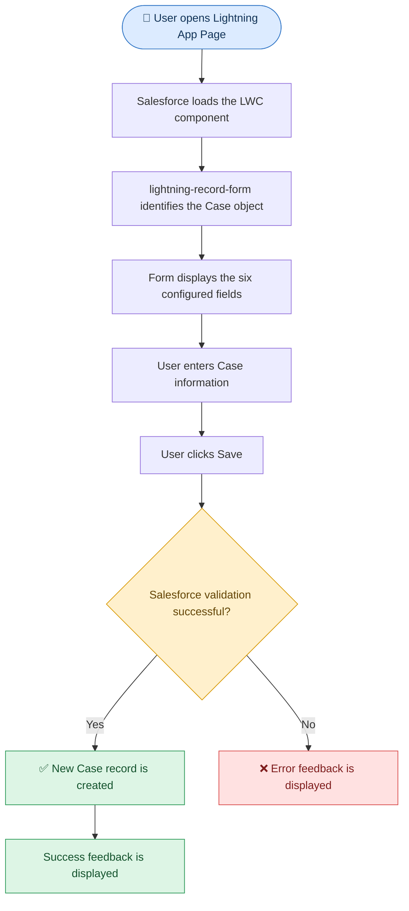

# Create a Record Without Apex in LWC

## Introduction

In this example, we create a new Case record using `lightning-record-form` without writing an Apex class.

The component displays a form containing the following fields:

- Subject
- Type
- Reason
- Origin
- Priority
- SLA Violation (`SLAViolation__c`)

The user enters the required information and submits the form to create a new Case record.

## Creating a Record with lightning-record-form


`lightning-record-form` supports three modes:

- `view`: Displays an existing record.
- `edit`: Displays an existing record in edit mode.
- `readonly`: Displays an existing record in read-only mode.

For a new record, the form can use `mode="edit"` **without specifying `record-id`**. In this situation, the form operates in record-creation mode.

### Syntax

```html
<lightning-record-form
    object-api-name="Case"
    fields={fields}
    mode="edit">
</lightning-record-form>
```

### Explanation

| Attribute | Explanation |
|---|---|
| `object-api-name="Case"` | Identifies the Salesforce object for the new record. |
| `fields={fields}` | Supplies the list of fields to display in the form from the JavaScript property. |
| `mode="edit"` | Provides editable inputs so the user can enter new record values. |
| `record-id` omitted | No existing record ID is supplied because the form is creating a new record. |

When the user submits the form successfully, Salesforce creates a new Case record.

## Understanding the Fields Array


The JavaScript controller defines the fields that appear in the form.

```javascript
fields = [
    'Subject',
    'Type',
    'Reason',
    'Origin',
    'Priority',
    'SLAViolation__c'
];
```

Each string represents a field API name on the Case object.

| Field API Name | Purpose |
|---|---|
| `Subject` | Short description of the Case. |
| `Type` | Categorizes the Case. |
| `Reason` | Specifies why the Case was created. |
| `Origin` | Identifies where the Case originated. |
| `Priority` | Indicates the urgency of the Case. |
| `SLAViolation__c` | Custom field intended to track SLA violation. |

The standard Case fields may appear as text inputs or picklists depending on their field metadata.

**Note:** `SLAViolation__c` must exist on the Case object in your Salesforce org. The user must also have the appropriate field permissions.

## Why Is record-id Not Required?


When editing an existing record, the form needs a record ID to identify which record to update.

When creating a new record, there is no existing record ID to provide.

Therefore, this example omits `record-id`:

```html
<lightning-record-form
    object-api-name="Case"
    fields={fields}
    mode="edit">
</lightning-record-form>
```

Salesforce treats this configuration as a form for entering and creating a new record.

## Complete HTML Code

```html
<template>
    <lightning-card
        title="Create a Case Record without Apex class">

        <lightning-record-form
            object-api-name="Case"
            fields={fields}
            mode="edit">
        </lightning-record-form>

    </lightning-card>
</template>
```

### Explanation

| HTML Element / Attribute | Explanation |
|---|---|
| `<lightning-card>` | Provides a card container with a title for the Case creation form. |
| `<lightning-record-form>` | Automatically renders the specified fields and handles the standard form submission workflow. |
| `object-api-name="Case"` | Specifies that the form will create a record of the Case object. |
| `fields={fields}` | Connects the form to the field list defined in JavaScript. |
| `mode="edit"` | Provides editable fields for entering the new record's information. |

## Complete JavaScript Code

```javascript
import { LightningElement } from 'lwc';

export default class CreateARecord
    extends LightningElement {

    fields = [
        'Subject',
        'Type',
        'Reason',
        'Origin',
        'Priority',
        'SLAViolation__c'
    ];
}
```

### Explanation

| Code | Explanation |
|---|---|
| `import { LightningElement } from 'lwc';` | Imports the base class required to create an LWC component. |
| `export default class CreateARecord extends LightningElement` | Defines and exports the component class. |
| `fields = [...]` | Defines the Case field API names that should be displayed in the form. |
| No Apex controller | A custom Apex class is not required for this basic record-creation workflow. |
| No custom save method | The standard record form handles submission through Salesforce's record APIs. |

## Understanding the Metadata XML

```xml
<?xml version="1.0" encoding="UTF-8"?>
<LightningComponentBundle
    xmlns="http://soap.sforce.com/2006/04/metadata">

    <apiVersion>67.0</apiVersion>
    <isExposed>true</isExposed>

    <targets>
        <target>lightning__AppPage</target>
    </targets>

</LightningComponentBundle>
```

### Explanation

| XML Element | Explanation |
|---|---|
| `<apiVersion>67.0</apiVersion>` | Specifies the Salesforce API version used by the component. |
| `<isExposed>true</isExposed>` | Makes the component available for supported Lightning App Builder usage. |
| `<targets>` | Defines the locations where the component can be used. |
| `<target>lightning__AppPage</target>` | Allows the component to be added to a Lightning App page through Lightning App Builder. |

Because this component creates a new record and does not depend on an existing record ID, it is suitable for a page where users can initiate Case creation.

## Step-by-Step Execution Flow



## How to Use This Component

1. Create the `createARecord` LWC in VS Code.
2. Add the HTML, JavaScript, and XML files.
3. Deploy the component to your Salesforce org.
4. Open Lightning App Builder.
5. Create or edit a Lightning App page.
6. Drag the component onto the page.
7. Save and activate the page as appropriate.
8. Open the page and test creating a Case.

## Important Considerations

1) **Required fields**

   If the Case object has required fields that are not included in the form, the record may fail to save. Add any necessary fields or ensure that Salesforce defaults and automation supply valid values.

2) **Custom field availability**

   Confirm that `SLAViolation__c` exists and that users have permission to access it.

3) **Validation rules**

   Salesforce validation rules can prevent the record from being created if the submitted values do not satisfy the configured conditions.

4) **User permissions**

   The current user must have permission to create Case records and access the requested fields.

5) **No Apex does not mean no server processing**

   Salesforce still processes the record creation through its platform APIs. The difference is that this component does not require a custom Apex class.

## Questions

1. **What is the purpose of this component?**

   It creates a new Case record using a standard Lightning base component without custom Apex code.

2. **Why is `record-id` omitted?**

   Because the form is creating a new record rather than updating an existing record.

3. **Which mode is used to create the record?**

   `mode="edit"` is used with no record ID to provide the inputs for a new record.

4. **What does `object-api-name="Case"` specify?**

   It identifies the Salesforce object for the record being created.

5. **What is the purpose of the `fields` array?**

   It specifies which fields should appear in the form.

6. **Is an Apex class required for this example?**

   No. The standard `lightning-record-form` handles the basic record-creation workflow.

7. **What happens if a required field is missing?**

   The record may not be saved unless a valid default or automation supplies the required value.

8. **Can this component be placed on a Lightning App page?**

   Yes. The metadata declares the `lightning__AppPage` target.

9. **What is `SLAViolation__c`?**

   It is a custom field name that must exist in the Salesforce org for the form to use it.

10. **Does Salesforce validation still apply when using LDS?**

    Yes. Required fields, validation rules, permissions, and other applicable platform rules continue to apply.
