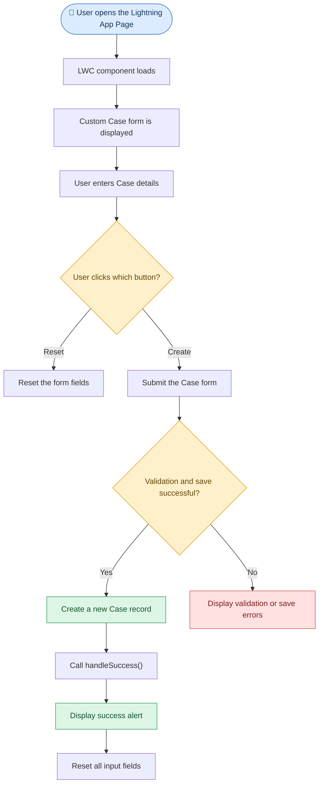

# Create a Record with Custom Layout in LWC

## Introduction

In Salesforce LWC, we can create a record with a custom layout using `lightning-record-edit-form`.

Unlike `lightning-record-form`, which automatically manages much of the standard form layout, `lightning-record-edit-form` gives us more control over the placement of fields, buttons, and other elements.

In this example, we create a Case record without writing an Apex class.

The form contains:

- Subject
- Origin
- Status
- Type
- SLA Violation (`SLAViolation__c`)
- Reason
- Description

It also provides **Reset** and **Create** buttons. After a successful save, a success alert appears and the fields are reset.

## Understanding lightning-record-edit-form


`lightning-record-edit-form` is a Salesforce base component that provides a form for creating or updating a record using Lightning Data Service.

It works with other components, such as `lightning-input-field`, to display individual record fields.

### Syntax

```html
<lightning-record-edit-form object-api-name="Case" onsuccess={handleSuccess}>
    <lightning-messages></lightning-messages>
    <lightning-input-field field-name="Subject"></lightning-input-field>
    <lightning-button label="Create" type="submit"></lightning-button>
</lightning-record-edit-form>
```

### Explanation

| Code | Explanation |
|---|---|
| `lightning-record-edit-form` | Creates a form for entering or editing Salesforce record data. |
| `object-api-name="Case"` | Specifies that the form works with the Case object. |
| `onsuccess={handleSuccess}` | Calls the JavaScript `handleSuccess()` method after the record is saved successfully. |
| `lightning-messages` | Displays relevant validation and save error messages. |
| `lightning-input-field` | Displays an input for a Salesforce field. |
| `type="submit"` | Submits the form when the user clicks the button. |

## Understanding lightning-input-field


`lightning-input-field` displays a field belonging to the object specified in `lightning-record-edit-form`.

Salesforce automatically uses the field's metadata to determine how it should appear, such as a text input, picklist, or other supported field type.

### Syntax

```html
<lightning-input-field field-name="Subject" required></lightning-input-field>
```

### Explanation

| Attribute | Explanation |
|---|---|
| `field-name="Subject"` | Specifies the API name of the Case field to display. |
| `required` | Marks the Subject field as required in the form. |
| `field-name="Origin"` | Displays the Case Origin field. |
| `field-name="Status"` | Displays the Case Status field. |
| `field-name="SLAViolation__c"` | Displays the custom SLA Violation field, provided it exists and is accessible. |
| `field-name="Description"` | Displays the Case Description field. |

**Important:** The field API names must match the fields available on the Case object in your Salesforce org.

## Understanding the Custom Layout with SLDS


Salesforce Lightning Design System (SLDS) provides CSS utility classes that help arrange fields in a responsive grid.

In this example, most fields use one-third of the available row width, while the Description field spans the full row.

### Syntax

```html
<div class="slds-grid slds-wrap">
    <div class="slds-size_1-of-3">
        <lightning-input-field field-name="Subject"></lightning-input-field>
    </div>
    <div class="slds-size_1-of-3">
        <lightning-input-field field-name="Origin"></lightning-input-field>
    </div>
    <div class="slds-col slds-size_3-of-3">
        <lightning-input-field field-name="Description"></lightning-input-field>
    </div>
</div>
```

### Explanation

| SLDS Class | Explanation |
|---|---|
| `slds-grid` | Creates a grid layout for arranging child elements. |
| `slds-wrap` | Allows elements to wrap onto another line when needed. |
| `slds-size_1-of-3` | Sets the element's width to one-third of the available width. |
| `slds-col` | Identifies an element as a grid column. |
| `slds-size_3-of-3` | Sets the element's width to the full available row width. |

## Complete HTML Code — `createRecordWithCustomLayout.html`

```html
<template>
    <lightning-card title="Create a Custom Case Record without Apex">
        <lightning-record-edit-form object-api-name="Case" onsuccess={handleSuccess}>
            <lightning-messages></lightning-messages>
            <div class="slds-grid slds-wrap">
                <div class="slds-size_1-of-3">
                    <lightning-input-field field-name="Subject" required></lightning-input-field>
                </div>
                <div class="slds-size_1-of-3">
                    <lightning-input-field field-name="Origin"></lightning-input-field>
                </div>
                <div class="slds-size_1-of-3">
                    <lightning-input-field field-name="Status"></lightning-input-field>
                </div>
                <div class="slds-size_1-of-3">
                    <lightning-input-field field-name="Type"></lightning-input-field>
                </div>
                <div class="slds-size_1-of-3">
                    <lightning-input-field field-name="SLAViolation__c"></lightning-input-field>
                </div>
                <div class="slds-size_1-of-3">
                    <lightning-input-field field-name="Reason"></lightning-input-field>
                </div>
                <div class="slds-col slds-size_3-of-3">
                    <lightning-input-field field-name="Description"></lightning-input-field>
                </div>
                <div class="slds-col slds-p-around_small">
                    <lightning-button label="Reset" type="reset"></lightning-button>
                    <lightning-button label="Create" type="submit" variant="brand" class="slds-m-left_small"></lightning-button>
                </div>
            </div>
        </lightning-record-edit-form>
    </lightning-card>
</template>
```

### Explanation

| Code | Explanation |
|---|---|
| `<lightning-card>` | Displays the form inside a Lightning card with a title. |
| `object-api-name="Case"` | Specifies the object for which a record will be created. |
| `onsuccess={handleSuccess}` | Invokes the JavaScript success handler after a successful save. |
| `<lightning-messages>` | Shows relevant errors from the form submission. |
| `slds-grid slds-wrap` | Arranges the fields in a grid and allows wrapping. |
| `required` on Subject | Marks Subject as required in this form. |
| `slds-size_1-of-3` | Places each field in approximately one-third of the row. |
| `slds-size_3-of-3` | Allows Description to occupy the full row. |
| `label="Reset" type="reset"` | Provides a reset action for the form. |
| `label="Create" type="submit"` | Submits the form to create a Case record. |
| `variant="brand"` | Applies the brand styling to the Create button. |

## Complete JavaScript Code — `createRecordWithCustomLayout.js`

```javascript
import { LightningElement } from 'lwc';

export default class CreateRecordWithCustomLayout extends LightningElement {
    handleSuccess() {
        alert('Your case is created successfully');

        const inputFields = this.template.querySelectorAll('lightning-input-field');

        inputFields.forEach(field => {
            field.reset();
        });
    }
}
```

### Explanation

| Code | Explanation |
|---|---|
| `import { LightningElement } from 'lwc';` | Imports the base class for an LWC component. |
| `handleSuccess()` | Defines the method called when the record is saved successfully. |
| `alert('Your case is created successfully')` | Displays a browser alert confirming successful creation. |
| `this.template.querySelectorAll('lightning-input-field')` | Selects all `lightning-input-field` components inside this component's template. |
| `inputFields.forEach(...)` | Iterates through the selected fields. |
| `field.reset()` | Resets an individual input field to its initial value. |

**Why reset the fields?**

After the record is created successfully, resetting the inputs prepares the form for another record. The `reset()` method resets the field values; it does not delete the record that was just saved.

**Note:** The original code also contains a commented-out attempt to reset the form itself. The active approach resets the individual input fields.

## Understanding the Metadata XML

### Complete Code — `createRecordWithCustomLayout.js-meta.xml`

```xml
<?xml version="1.0" encoding="UTF-8"?>
<LightningComponentBundle xmlns="http://soap.sforce.com/2006/04/metadata">
    <apiVersion>67.0</apiVersion>
    <isExposed>true</isExposed>
    <targets>
        <target>lightning__AppPage</target>
    </targets>
</LightningComponentBundle>
```

### Explanation

| XML Element | Explanation |
|---|---|
| `<apiVersion>67.0</apiVersion>` | Specifies the Salesforce API version used by the component. |
| `<isExposed>true</isExposed>` | Makes the component available for supported Lightning App Builder usage. |
| `<targets>` | Defines where the component can be placed. |
| `<target>lightning__AppPage</target>` | Makes the component available on a Lightning App page. |

## Understanding Reset and Create Buttons

### Reset Button

```html
<lightning-button label="Reset" type="reset"></lightning-button>
```

The Reset button uses the form's standard reset behavior. It is intended to restore fields to their initial values without creating a record.

### Create Button

```html
<lightning-button label="Create" type="submit" variant="brand"></lightning-button>
```

The Create button submits the form. Salesforce validates the entered values and attempts to save the record.

| Button | Type | Purpose |
|---|---|---|
| Reset | `reset` | Resets the form's input fields to their initial values. |
| Create | `submit` | Submits the form to create a Case record. |

## Step-by-Step Execution Flow



## How to Use This Component

1. Create an LWC component named `createRecordWithCustomLayout`.
2. Add the HTML, JavaScript, and XML code.
3. Deploy the component to your Salesforce org.
4. Open Lightning App Builder.
5. Create or edit a Lightning App page.
6. Drag the custom component onto the page.
7. Save and activate the page as appropriate.
8. Open the page, enter the Case details, and click Create.
9. Verify that the record was created successfully.

## Questions

1. **What is `lightning-record-edit-form`?**

   A Salesforce base component used to create or update records with a customizable form layout.

2. **What is the purpose of `lightning-input-field`?**

   It displays an input for a field on the specified Salesforce object.

3. **What does `onsuccess={handleSuccess}` do?**

   It calls `handleSuccess()` after the record is successfully saved.

4. **Why do we use `lightning-messages`?**

   It displays relevant validation and record-save error messages.

5. **What is the purpose of `slds-grid slds-wrap`?**

   It arranges fields in a grid and allows them to wrap onto additional rows.

6. **What does `type="submit"` do?**

   It submits the form when the Create button is clicked.

7. **What does `type="reset"` do?**

   It invokes the form's standard reset behavior.

8. **Why is `querySelectorAll()` used in `handleSuccess()`?**

   It selects all the `lightning-input-field` components so they can be reset.

9. **Does resetting the fields delete the created record?**

   No. Resetting the fields changes the form inputs, not the saved record.

10. **Is an Apex class required for this example?**

    No. Salesforce handles the basic record-save operation through its standard record services.
